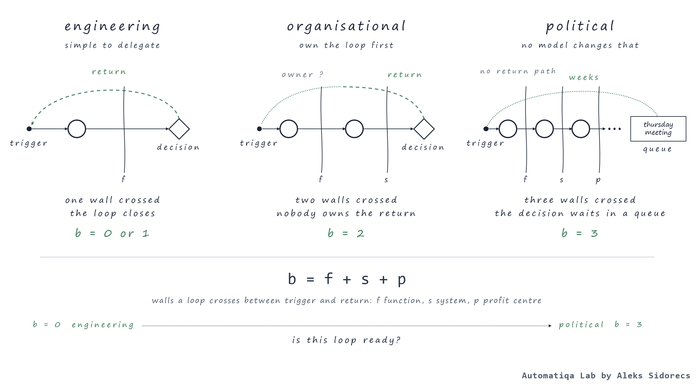

# Decision loop readiness

*Heuristic 03. Published 17 October 2026 on [sidorecs.com](https://www.sidorecs.com/heuristics/03-decision-loop-readiness/).*

*Assess the loop, not the company.*

## Problem

### Why do AI readiness scores never tell you what supply chain operation should do on Monday?

**Every agentic AI readiness assessment I’ve seen tends to score a specific segment of operations or a whole company. I have a problem with that approach; in 99% of cases, every agent I’ve built or deployed across operations stalled at a decision point.**

I’ve used process mapping/frameworks (e.g. value streams from Lean Six Sigma, BPMN) for most of my supply chain and transformation career. The key aha moment for me, which sparked a lot of reflection, came when I started applying process diagrams to define activity zones that could be handed off to an AI agent. Like a case where 60+ workflows for the order-to-cash pillar were identified by our team. In the diagram, each candidate represents a clean lane with triggers and steps. You can see inputs, processing steps/execution and final outputs highlighted. But that’s how it looks on paper or on a PowerPoint slide. When you hand each such workflow to Agentic AI, it reaches the point where a human must decide, and that is where all the promised miracles vanish. 10 cases like this shifted my thinking and led me to conclude the problem wasn’t triggered by an unread agent or company. The loop itself was a core issue - by design.

Since then, I've stopped asking how prepared my company or its supply chain is for agentic AI. Instead, I'm asking how prepared the specific decision loop is.

## Why it's hard

### A company doesn’t decide. A decision loop does.

Why doesn’t scoring company-level readiness make sense? Because readiness is a property of things that have a capability to respond. The company itself (as a standalone unit of measure) can't respond per se. The response property (or capacity) comes via individual decision-making loops within a company instead. [Heuristic 01](../01-requisite-variety-in-supply-chain/) indicated that the variety of possible responses should be at least as wide as the variety of incoming stimuli from the outside world/internal operations. On top of that, an operating model diagram or org. chart can't capture the range of possible responses because each decision loop triggers a response individually - through the person owning the loop when a supply chain exception lands on the desk Monday at 9:00 am. As soon as we average this across the entire organisation to get a single readiness score, we risk creating a number with no real substance.

I define the term decision loop as a network of handovers that ends in a specific decision, combined with a feedback loop that sends the outcome back to the person who will decide next time.

The process map, irrespective of the methodology we use, rarely captures the network of handovers that lead to specific decisions. I've rarely seen any that captured the inputs the decision-maker had on hand (at the moment of deciding), and the same applies to tracing the outcome loop. Process maps are illusory because most of the flows look fine on paper only. In daily operations, loops often stay open because a specific task waits for a Thursday meeting; an operator decides over the phone, and no one records it in any database; or an outcome never reaches the person who needs it most.

Another challenge: decision loops tend to cross many boundaries (that’s why I use the term “network of handovers”), and process diagrams tend to fully ignore that. For example, when the loop stays inside one function and one system, it's kind of a technical job. Its sister loop that crosses a function, a system, and a specific profit centre often becomes political, regardless of the scale and impact of the decision. That’s why, in my opinion, a company-level assessment/scoring can’t see the difference and, most likely, is one of the key reasons some pilots get cherry-picked for visibility (political) but are forced to die because they have low or no real impact across operations or the broader business. 

## The rule

### One loop, traced end to end, before any paid assessment

*Before you **decide** to engage paid readiness assessment from consultants or launch a pilot - just pick one decision loop and assess that.* The objective is simple: to trace the flow from the trigger to the decision and through the return path of outcomes. Here we also should count the number of boundaries it’s going to cross. Based on those inputs, you can judge the specific decision loop's AI handover readiness. Then you repeat it for the next loop and so on. The temptation is to average results into a score/rating, but the problem, as many supply chain practitioners would recognise, is that the average is exactly where information and signals die.

> **b = f + s + p**
>
> f, s and p are 1 if the loop crosses a function, a system or a P&L boundary between trigger and return, 0 if not. b runs from 0 to 3. You can also extend this formula to add more variables, since no single company runs decision loops on a unified template compared to ERP systems.
>
> It ensures the proper triangulation, validating in detail the type of work the loop needs to become AI agent-friendly:
>
> - b = 0 or 1 points to boring engineering work - very easy and simple to delegate 
> - b = 2 drifts you to organisational design issues first (instead of simple AI deployment); someone must own a loop that currently crosses two functions.
> - b = 3 gets us into political games. No model type or quality is going to change that.
>
> ***x** from [Heuristic 02](../02-asymmetric-supply-chain-physics/)* calculates how much variety lands in your organisation from outside the company walls. In Heuristic 03, b points to many intra-company walls it's crossing before anyone actually responds to it.

## Test

### Is this loop ready?

Pick one decision from the last three weeks. Important that you pick really a decision, not a process or KPI - just a decision. Next step is to answer from the angle of what has happened (not from the procedure!):

1. **Who decided?** Can you identify the person and the specific moment in time and space? In cases where the answer points you to something like “the Thursday meeting” - it’s not a loop at all; it’s a queuing issue.
2. **What inputs were available?** List the inputs that were available to support the decision (in the moment it was made). Also make sure to capture the ones that should have been there but weren’t by the time of making it (very important).
3. **Did it return the outcome?** Did the outcome reach the person (with a form/shape that they can use or apply) who's likely to take the same decision next time?

**Three “yes” and b ≤ 1: the loop is ready for agentic AI. Just one “no“: the operational readiness score/rating is irrelevant until this loop closes.**

## Run on

> Here's a case from my practice: a customer order with 25 containers in transit through the Indian Ocean. The client became insolvent, and the decision looked easy - we just had to reroute the order with 40-foot containers by changing the port of destination (POD). Final outcome? We had to sign off on payment to the shipping line for demurrage and detention charges of nearly USD 1 million. The main driver was that it took the organisation nearly four weeks to sync internally and resolve the issue.
>
> Now let me demonstrate how tracing the loop works. First, we identify the trigger: the insolvency notice from the client in Slovenia that lands on the credit risk department's desk. Next, we spot the first handover to a sales team member who managed the contract and relationships with company X. No surprise that the second handover landed with the logistics operator who handled shipment execution and title documents (e.g. Bill of Lading). The third handover went to finance - they owned the exposure. The output loop - there's none, which means that next time (in similar cases) the loop would start from zero.
>
> What was on the hands (in terms of inputs) when the situation developed that way: the exposure figure arrived after the carrier’s free time had run out. Did it come back: no. b = 3 - function, system (contract, booking, ledger) and P&L (one unit had sold, another held the stock).

## How this rule gets misapplied

- Hiring external advisors for a company-level readiness score assessment and using it to define an AI deployment roadmap across operations. As mentioned above, the biggest problem with this approach is that it's going to average closed loops with open ones and likely will highlight “medium” readiness for the whole bucket.
- Diagnosing the process flow instead of the decision loops. The value stream map (VSM) will always look perfect. But reality will always drift from the diagram because the VSM doesn’t account for an invisible part represented by a decision at the 7th step waiting for a cross-functional meeting.
- Choosing the first loop by initiative visibility (political) or the one that the leadership team asks about, instead of prioritising by b. A b = 3 represents reorganisation at full scale, not a pilot.
- Considering that your loop is ready since the data exists. The inputs in the warehouse and the inputs the decision maker had at a specific moment are completely different and irrelevant things.
- Deploying an AI model on a loop nobody really traced. I’ve done this: yes, the model finally worked, but the decision point it fed hadn’t been mapped. As a result, the loop never closed, and expected ROI from agentic deployment was behind vs. initial business case indication.

---

> **A company is never ready. A loop is, or it isn’t.**
