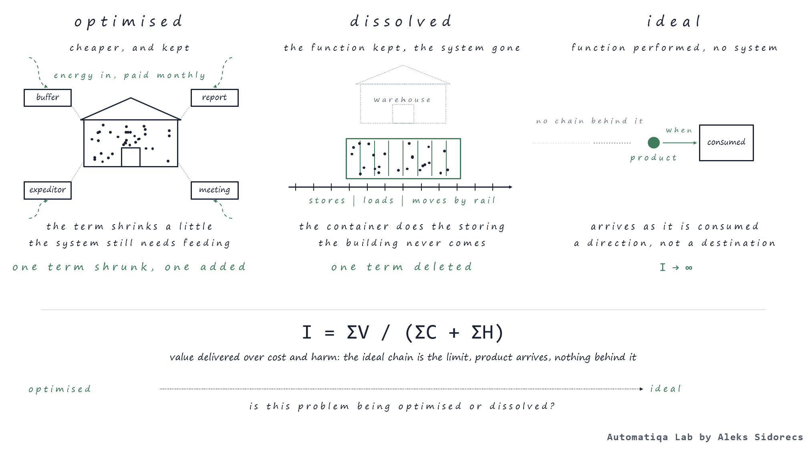
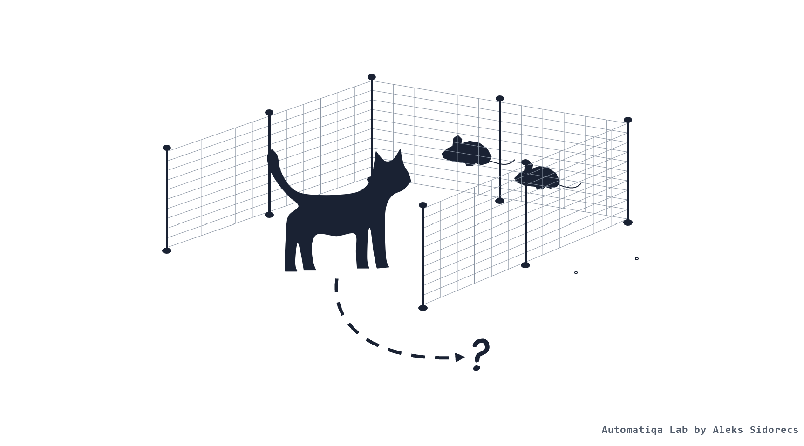
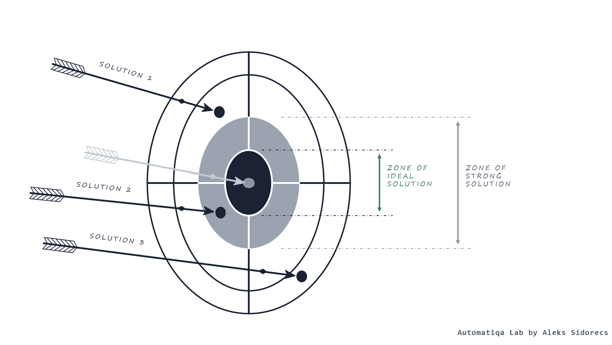

# Dissolve the problem, don't just (sub-) optimise the supply chain

*Heuristic 04. Published 1 November 2026 on [sidorecs.com](https://www.sidorecs.com/heuristics/04-dissolve-the-problem/).*

## Problem

### Why does every continuous improvement initiative leave the problem in place?

**Every improvement initiative I've signed off or shown did the same to any problem - it just became much cheaper to maintain.**

The key challenge is that every individual problem across operations with an assigned KPI has a tenure. Yes, we can improve specific parts of operational execution, and if we do it right, we would observe specific KPIs start drifting toward a target state. I've delivered many such initiatives, whether improving working capital by optimising forecasting and cash flows, or by reducing demurrage and detention costs through better planning of inbound flows from port terminals to destination warehouses. The key issue is that the problem shrinks, but it remains permanent twelve months later.

I'm continuously asked to deliver supply chain configurations that are agile and lean, powered by high service levels against cost targets that the company defines for its P&L periods. Those aren't trade-offs a plan could balance as it was in pre-COVID times. As a result, I developed a habit of seeking new methods outside of the classical supply chain and operations textbooks (or legacy career experience). In the early 2020s, this led me to [TRIZ](https://en.wikipedia.org/wiki/TRIZ), a concept I trained in for three years and earned certification in through applied problem-solving use cases in daily operational work.

One key TRIZ definition that initially caught my attention and dropped me into a rabbit hole of inventive problem-solving exploration was this: the function is performed, but there is no system doing it. Take a minute to reflect. I do still remember how it made me think intensely and repeat those words over the next few days before I sat down, took paper and redefined it for my discipline: the customer (or consumer) receives the product, with no supply chain behind it. That is how the concept of Idealised Supply Chain Design started forming in my head, and I still use it to this day.

## Why it’s hard. Very, very hard.

### Operations are built to solve - they are not designed to dissolve issues

**An optimised problem is a disorder held in place by energy, and the energy bill never stops.** It's interesting how [John Boyd](https://en.wikipedia.org/wiki/John_Boyd_(military_strategist)) translated the [second law of thermodynamics](https://en.wikipedia.org/wiki/Second_law_of_thermodynamics) for army and business strategists: even while effort intends to keep it as is, any system in any condition will have a natural tendency to drift toward disorder (always!). As a result, the more control we try to impose, the more energy (e.g., organisational) it would take to maintain the status quo. In the supply chain, this energy shows up as a stock buffer, a status update report, an additional vendor, or thirty-minute meetings for shipment review at our factory in Germany.

Another systems thinker who significantly influenced my operational philosophy is [Russell Ackoff](https://en.wikipedia.org/wiki/Russell_L._Ackoff). In his works and lectures, he often mentioned four ways to treat any operational problem: absolve it, resolve it, solve it, dissolve it:

- situations when we hope it just goes away define absolving
- when we deploy a good enough or acceptable fix is resolving
- solving becomes the best answer any system allows - that's where optimisation happens
- to ensure that same problem doesn't occur, we have to dissolve specific elements of the environment it sits in.

What matters is that the middle two are what a typical supply chain function measures and rewards. At the same time, design decisions sit in another’s budget (e.g. CAPEX, commercial or IT), since the fourth is a pure design act. I remember a multi-billion family business that owned every factory across four countries in the baby care medical devices sector - previously, market entry was defined by greenfield CAPEX projects and their deployment lead time. But it didn't take long for new players to figure out how (triggered by [Obamacare](https://en.wikipedia.org/wiki/Affordable_Care_Act) opportunities) because they relied on outsourcing (contract manufacturing) to enter those markets first. Lead time was a property of a choice, so the choice was never on the table.

The word choices (especially the nouns) do the rest. When we define the problem through the noun 'warehouse', somehow every solution becomes linked to a physical facility. When we pick 'forecast error', every solution centres on better forecasting. I call it self-hypnosis because, before anything starts, the term's usage already programs the search for a solution, and it looks exactly like the cat in the following figure:

That's the reason I argue that the function to store something has more solutions than the noun (e.g. warehouse) does. The key issue here is that optimisations are often more legible than dissolutions. Baseline, target and before-and-after indicators mark optimisation outcomes. In the case of dissolutions - things that are measured just gone and there's no after-metric. For example, that's why cost savings and cost avoidance are permanent topics of discussion between Head of Function and Finance teams. Well, nobody gets a bonus for a KPI that no longer exists.

## The rule

### Say the function without the noun and ask what would make the problem impossible

**Always frame the function the problem sits on without using its name before pushing an improvement initiative. You must clarify what conditions or elements must be true for any problem to stop (re-) appearing at all.** You only optimise what you failed to dissolve, not vice versa. Register the failed attempt in the business case (in the form of a post-action debrief), so the next person doesn't start from scratch.

> **I = ΣV / (ΣC + ΣH)**
>
> Two TRIZ principles shape the core of this heuristic. Meaning that, for less cost and harm, systems must evolve toward more useful function. The ideal final result is when the supply chain function (e.g. goods delivery) is performed, and the system executing it is no longer needed. Ideality (I) is the sum of Value (V) it delivers (speed, flexibility, availability) over the sum of costs (C) to run and harm (H) produced (waste, lead time, working capital, emissions). Again, when the product arrives and nothing is behind it - it's the ideal chain condition we should aim for.
>
> It's also interesting to see how the same ratio moves differently with optimisation and dissolution initiatives - the same ratio moves in two different ways. For example, if we take storage costs as the denominator - optimisation is likely to shrink it by a few per cent. But it also adds a few elements to hold optimisation outcomes there: an additional stock report or system, buffer rules, etc.
>
> When the denominator falls by less than the savings, the new element triggers the next optimisation initiative. At the same time, when the dissolution initiative can set the new or existing element to zero, terms that existed only to watch it go with it. Because product still gets delivered, value on top does not move - the whole difference exists below the line.
>
> Match the variety or pay for the difference, says [Heuristic 01](../01-requisite-variety-in-supply-chain/). The third option this heuristic names is removing variety source inside your walls, leaving nothing to match.

## Test

### Is this problem being optimised or dissolved?

Pick one project from your backlog (avoid any temptation to run it as a workshop!).

1. **Write down the noun.** Here we describe the problem as anyone names it: demurrage, forecast error or late delivery.
2. **Write down the function it performs (no nouns in the sentence!)** It can be: 'to store', 'to move', and 'to recondition'. Test point here: if you cannot say it without the noun, the noun owns the project.
3. **Ask the ideality question three times.** Formula elements might guide you, for example: a. can the function be at no cost?, b. can the function be performed without any execution/operational system behind it?, c. can it be performed with no harm, waste and inventory?
4. **Review the whole business case.** Does it still point to the specific KPI and owner?

**The problem will not go away if you keep the noun and the KPI/owner survive the project. It makes sense to fund it only after dissolution activities were attempted and recorded as failed with key lessones and takeaways**

## Run on

> Back in 2021, a warehouse make-vs-buy assessment with the respective CAPEX letter was on my agenda for bulk products. The business case considered standard options such as leasing, construction, or redesigning existing facilities. Every scenario represented a greenfield or brownfield investment project. Before the first meeting, the noun 'warehouse' had already done its work of kicking off [psychological inertia](https://en.wikipedia.org/wiki/Psychological_inertia).
>
> So, in the middle of the business case development process, I decided to test a different approach. The noun was 'warehouse', and I reverted to its original function: to store goods between arrival and consumption. Two options appeared that the noun had hidden:
>
> - our customers had a lot of unused space at their facilities, so why not leverage it, especially for some of them it would be a significant lead time reduction (e.g. through vendor-managed inventory, while the rest of the stock could be repositioned for others when needed)
> - the second idea uncovered something more interesting: the container leverage. Containers are built to move, but nothing stops us from using them for storage (after some redesigns to ensure product quality doesn't deteriorate over time). Additional benefit: we could reposition containers with stock across locations where it would make sense, introducing additional operational efficiencies as tested through formula - so we this case.
>
> As a result, the goods stayed in the metal box, were stored in it, moved by rail etc. The unit that held the inventory became the unit that shipped it, so our yards became the warehouses.
>
> Later the ideality questions got applied to test the case: storage at no cost was close but not there; a container in a yard still cost a box and a yard. At the same time, the product still needed storage, and a function performed it. So, as such, full ideality wasn't reached. Despite this and thanks to avoiding self-hypnosis, we managed to step out of dancing around the noun 'warehouse'. The solution was elegant: one fewer system, fewer greenfield/brownfield projects, and no new KPIs to monitor.

## How this rule gets misapplied

- Dissolving the problem at the level of organisational structure. Merging two departments won't dissolve issues - it just hands the problem to a new owner.
- Optimisation automation. An AI agent can cut demurrage costs by booking trucks before the container lands at the terminal, using real-time vessel data. But containers still have to wait at the terminal. The reason is that inbound flow arrives faster than the warehouse can take at the moment (e.g. high season etc.). Indeed, the wait is shorter, but the cause and underlying issues stay untouched. It's just an optimisation powered by better inference, nothing more or different.
- Dissolving variety you don't own. You can't dissolve unexpected promotions that your largest customer decided to launch at the last moment as a reaction to their competitor's activities in the retail market. You can't influence their promotion calendar design decisions, but you can dissolve the part of design that turns such promotions into firefighting.
- Removing the control mechanism before the cause is addressed. Because of a cause, we introduce every necessary control across the chains. When the forecasts are consistently wrong - we introduce safety stocks. What if the project aims at removing the forecast error? Finance takes stock out in the first quarter to fund the initiative. Fast forward six months later - the buffer is gone, but the error didn't dissolve as such. The customer will feel that pain first. Only when the cause hasn't shown up for long enough can we be comfortable cutting the control mechanism.

---

> **A problem optimised is a problem kept.**
